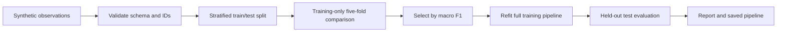

# Personality Prediction of Candidates

**Python · Data preprocessing · Feature engineering · Predictive modeling · Model evaluation**

A reproducible ML portfolio project that turns structured behavioral and skills-related inputs into **synthetic work-style classifications**. It demonstrates the engineering behind an experiment: validated data, leakage-aware preprocessing, model comparison, feature ablation, held-out evaluation, and reproducible prediction artifacts.

This is a **new reference implementation** based on the supplied project description. The original code, dataset, personality labels, and evaluation procedure were unavailable. All algorithms, features, and synthetic labels below are implementation choices for this repository, not recovered facts about the original project. This is not a validated personality test or an employment decision tool.

## Run the project

Requires Python 3.11 or newer. From this folder:

```sh
python3 -m venv .venv
source .venv/bin/activate
python -m pip install -e '.[dev]'
personality-lab generate
personality-lab train
personality-lab predict --data data/example_candidates.csv
pytest -q
ruff check src tests
```

Open `artifacts/REPORT.md` for the results and confusion matrix. The commands use seed 42 by default. `--seed`, `--rows`, `--data`, and `--output` allow independent runs; see `personality-lab --help` and the subcommand help. Use a fresh output directory for each experiment you want to preserve.

For the exact dependency versions used for the checked-in run:

```sh
python -m pip install -r requirements-lock.txt
python -m pip install --no-deps -e .
```

The lock records the tested Python 3.14 environment; the supported Python version matrix is defined in CI and has not necessarily been run locally.

## Skills demonstrated

| Competency | Concrete implementation |
| --- | --- |
| Python engineering | Installable package, CLI, configuration through arguments, isolated functions, tests, CI |
| Data analysis | Explicit schema, range checks, missingness and class-distribution summaries |
| Data preprocessing | Training-only median imputation, missingness indicators, standardization, one-hot encoding |
| Feature engineering | Behavioral/skill pair means inside a scikit-learn pipeline; raw-feature ablation |
| Predictive modeling | Majority baseline, logistic regression, and a random forest |
| Experiment design | Stratified holdout, training-only five-fold model selection, fixed seeds |
| Evaluation | Accuracy, balanced accuracy, macro F1, per-class precision/recall, log loss, confusion matrix |
| Interpretation | Held-out permutation importance and a bootstrap accuracy interval |
| Reproducibility | Dataset hash, package versions, split manifest, saved pipeline, inference parity tests |
| Responsible AI documentation | Synthetic provenance, model/data cards, explicit validity limits |

## How it works



Each candidate has six numeric inputs on an invented 1–5 scale and one activity preference. The generator uses arbitrary weighted rules plus noise to create `analytical`, `collaborative`, and `exploratory` labels, then introduces missing values. These labels have no psychometric standing and no ordering from better to worse. No real people or recruitment outcomes are represented.

Preprocessing is fitted independently inside each cross-validation fold. Candidate IDs, provenance, and the target never enter the feature matrix. The schema permits only one row per candidate, preventing the same ID appearing in both train and test. Supporting longitudinal observations would require grouped splitting and grouped CV.

The logistic raw/engineered comparison makes the feature-engineering contribution inspectable. Pair means are linear combinations, so they need not improve a linear model; the project does not claim a gain unless the measurements show one. Model selection includes the baseline, allowing it to win if learned models fail to improve on it.

## Results and evidence

The checked-in [experiment report](reports/REPORT.md) records the actual synthetic run. [Model comparisons](reports/model_comparison.csv) and [metrics](reports/metrics.json) provide the supporting values. Re-running training writes new results to `artifacts/` without replacing the checked-in report.

| Historical claim from supplied CV | Verification status |
| --- | --- |
| 92% test accuracy | Unverified: original dataset, labels, split, and model unavailable |
| 25% improvement in hiring accuracy | Unverified: metric, baseline, and outcome methodology unavailable |

Neither percentage is a target for this implementation. Performance on a known synthetic generator does not establish personality validity, performance on real candidates, hiring benefit, or fairness. No demographic data is generated, so no demographic fairness finding can be made.

## Output artifacts

| File under `artifacts/` | Purpose |
| --- | --- |
| `REPORT.md`, `confusion_matrix.png` | Human-readable evaluation |
| `metrics.json` | Metrics, class counts, missingness, seed, versions, dataset hash |
| `model_comparison.csv` | Training-only CV mean and standard deviation |
| `feature_importance.csv` | Raw-input permutation importance, computed through the full pipeline |
| `test_predictions.csv` | Auditable predictions and uncalibrated probabilities |
| `split_manifest.json` | Explicit candidate IDs in each split |
| `model.joblib` | Fitted preprocessing and estimator for reproducible inference |

Load only locally generated, trusted `joblib` files: pickle-based artifacts can execute code. Version compatibility is checked during prediction. Input files must identify their origin as synthetic; this is a scope check, not a way to verify provenance independently.

## Repository map

```text
src/candidate_personality/
  data.py          Synthetic generation and schema validation
  features.py      Pair features and preprocessing pipeline
  experiment.py    Model comparison, evaluation, persistence, inference
  cli.py           Generate / train / predict commands
data/              Reproducible synthetic dataset and example inference rows
reports/           Checked-in measured example, without binary model files
tests/             Validation, leakage, split, and serialization checks
docs/              Data card, model card, methodology, portfolio wording
.github/workflows/ Automated tests and lint
```

Read the [data card](docs/data-card.md), [model card](docs/model-card.md), [methodology](docs/methodology.md), and [portfolio notes](docs/portfolio.md) for definitions and interpretation.
