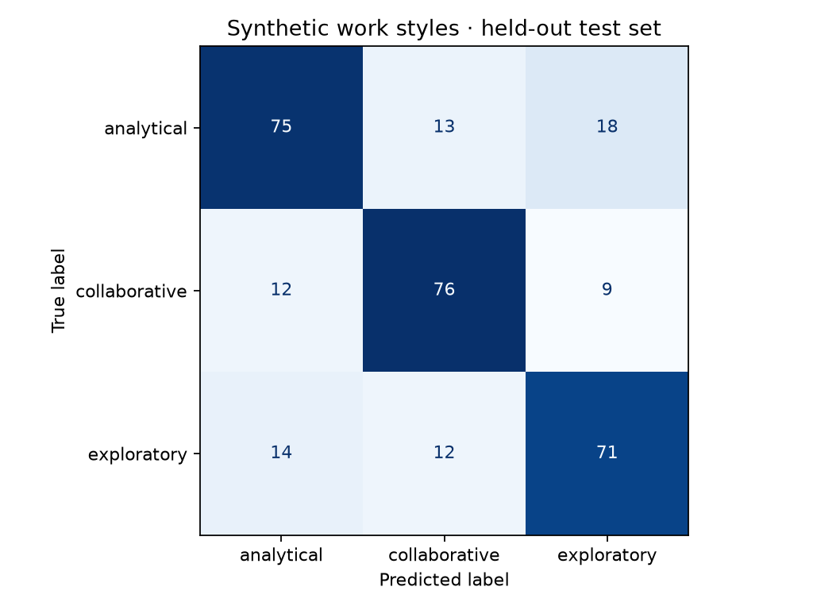

# Synthetic experiment results

This is a newly implemented educational experiment, not evidence of personality validity.

- Dataset: 1,200 fictional observations; seed 42.
- Split: 900 training / 300 test; unique candidate IDs.
- Selected model: **logistic_raw**, using training-only 5-fold macro F1.
- Held-out accuracy: **74.0%**.
- Held-out macro F1: **0.740**.
- Balanced accuracy: **0.741**.
- Log loss: **0.593**.
- Majority baseline accuracy: **35.3%**.
- Accuracy 95% bootstrap interval: 69.3%–79.3%.

The interval describes resampling uncertainty for this fixed model and synthetic test set;
it does not include training or population uncertainty. Probabilities are uncalibrated model
outputs. Permutation importance measures predictive reliance, not causal influence.
The raw/engineered logistic comparison is an ablation; feature engineering is not assumed
to improve results. The test set must not be reused for tuning.

See `model_comparison.csv`, `feature_importance.csv`, and `metrics.json` for details.
The historical 92% test accuracy and 25% hiring improvement are unverified source claims.
No hiring outcome is generated or evaluated here. No fairness or psychometric validation
has been performed, and this model must not be used to screen, rank, or reject people.
